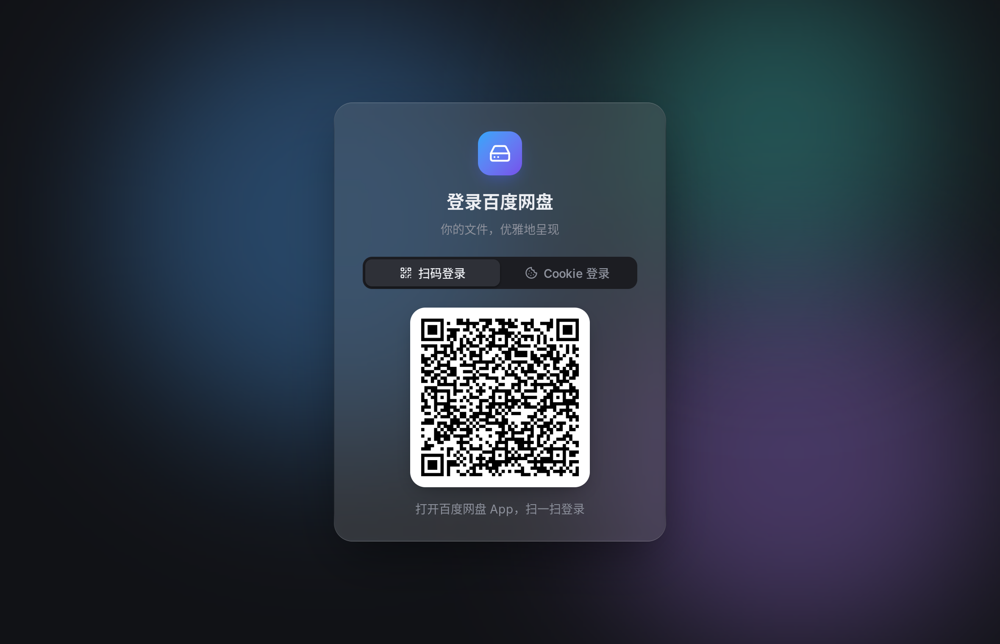
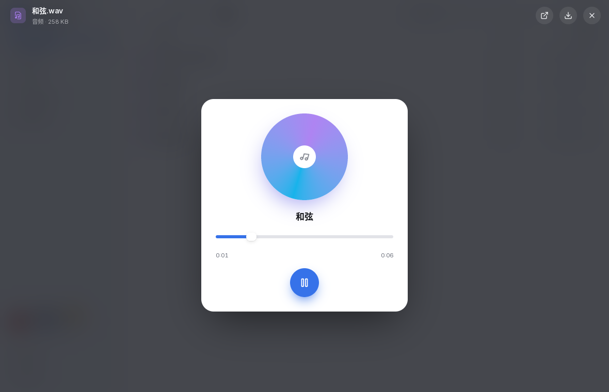

# BaiduNetGo

一个用纯 Go 写的百度网盘桌面客户端：界面由 [MyGo](https://github.com/egoist/mygo) 的原生 `ui` 包在 GPU 上绘制（没有 WebView、没有 cgo），网盘能力来自把 [BaiduPCS-Go](https://github.com/qjfoidnh/BaiduPCS-Go) 当作库使用。




## 特性

- **扫码登录**（百度网盘 App 扫一扫），或粘贴 Cookie / BDUSS+STOKEN；凭据用 AES-GCM 加密保存，密钥放在系统钥匙串
- **浏览**：列表 / 网格两种视图、缩略图、拼音排序、面包屑、前进后退、全盘搜索
- **不落盘预览**：文件只读进内存
  - 图片：从缩略图"长"出来的共享元素动画，滚轮缩放、拖拽平移、下拉关闭、←/→ 切换
  - 文本与代码（语法高亮，UTF-8 / GB18030 自动识别）、Markdown 渲染
  - PDF：PDFium 编译成 WebAssembly 在 wazero 中运行，逐页渲染，全平台无依赖
  - 音频：MP3 / OGG / WAV 边下边播
  - 视频（及其它音频）：取得直链交给 **mpv**，附带网盘要求的 User-Agent 与 Cookie
- **文件操作**：新建文件夹、重命名、移动 / 复制（文件夹选择器）、删除（可撤销）、回收站
- **传输**：多连接分块下载、断点续传、过期链接自动刷新；上传支持秒传与分片；拖文件进窗口即上传
- **分享**：创建带提取码与有效期的链接、管理我的分享、粘贴整段分享文字一键转存
- **离线下载**：HTTP / 磁力链接交给网盘云端下载
- 跟随系统深浅色、减弱动效设置；弹簧动画、交错入场、玻璃材质





## 开发

```bash
go tool mygo dev            # 带热重载运行
BAIDUNETGO_FAKE=1 go run .  # 连接内置的假网盘，不需要账号
go test ./...
go tool mygo build          # 打包当前平台（Linux 产出 .deb / tar.gz）
```

依赖：Go 1.27+；Linux 需要 GTK 3；播放视频需要安装 mpv（或在设置中指定路径）。代码不使用 cgo，可以从任意平台交叉编译到 Windows / macOS / Linux。

### 目录

| 路径 | 内容 |
|---|---|
| `app/` | 原生界面：登录、浏览、预览、对话框、传输、分享、设置 |
| `internal/baidu` | 网盘客户端：登录（含二维码）、列表、直链、文件操作、分享、离线 |
| `internal/remote` | 基于 HTTP Range 的内存读取，预览与边播 |
| `internal/pdf` | PDFium（WebAssembly）渲染 |
| `internal/player` | 查找并启动 mpv |
| `internal/transfer` | 下载 / 上传队列 |
| `internal/pcsport` | 移植自 BaiduPCS-Go internal 的上传流程 |
| `internal/fakepan` | 测试与演示用的假网盘服务 |

## 致谢

见 [NOTICE](NOTICE)。
