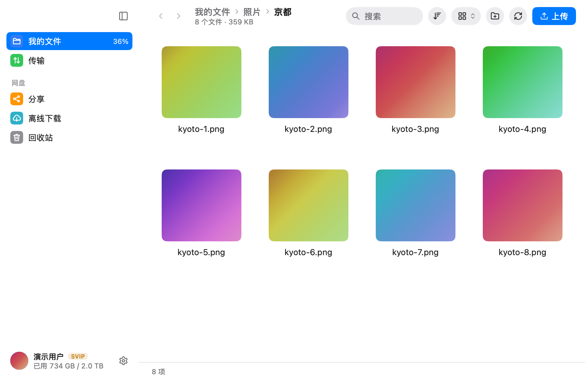
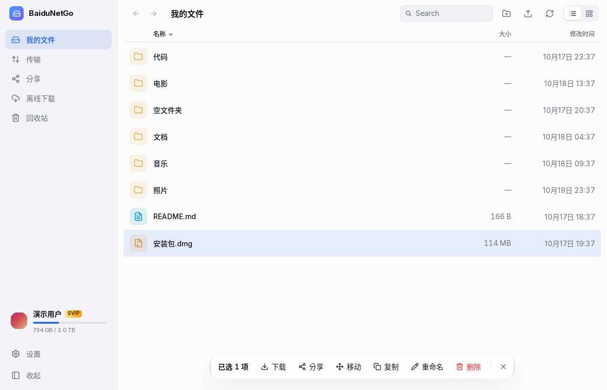
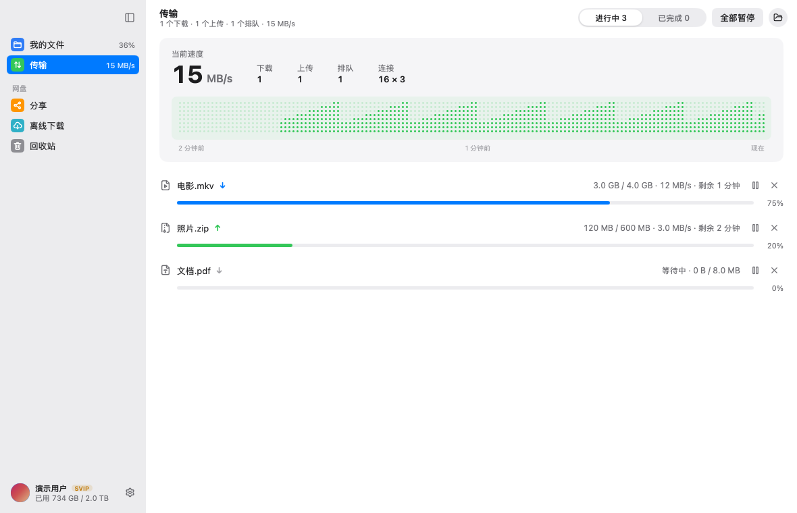
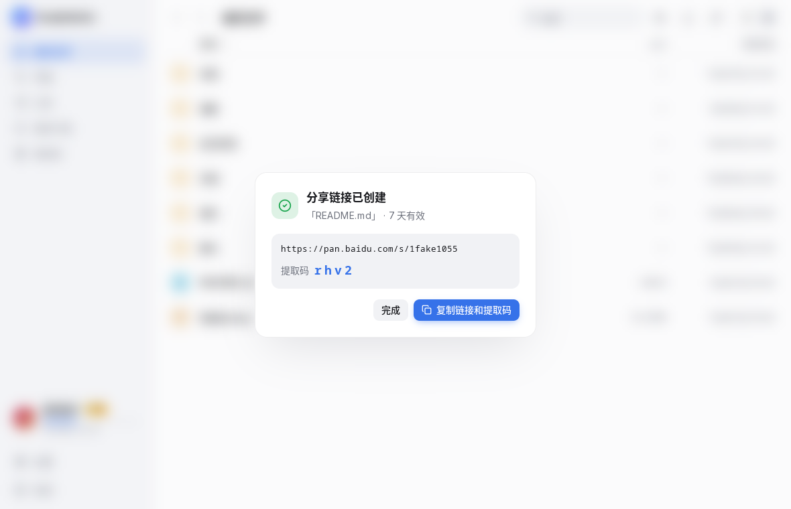
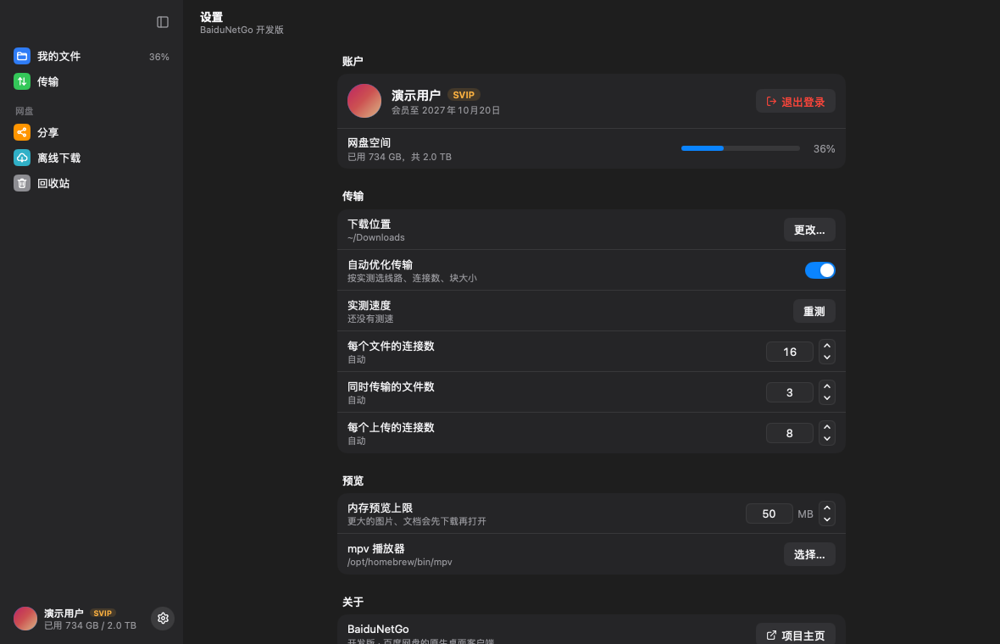

# BaiduNetGo

一个用纯 Go 写的百度网盘桌面客户端：界面由 [MyGo](https://github.com/egoist/mygo) 的原生 `ui` 包在 GPU 上绘制（没有 WebView、没有 cgo），网盘能力来自把 [BaiduPCS-Go](https://github.com/qjfoidnh/BaiduPCS-Go) 当作库使用。外观照 macOS 原生应用来做：侧边栏透出窗口材质、彩色图标块、条纹列表、圆角分组。



| | |
|---|---|
|  |  |
|  |  |

## 特性

- **登录**：百度网盘 App 扫码，或粘贴 Cookie / BDUSS+STOKEN；也能直接沿用本机百度网盘 Linux 客户端或 BaiduPCS-Go 的登录。凭据用 AES-GCM 加密保存，密钥放在系统钥匙串
- **浏览**：列表 / 网格两种视图，按名称（拼音）、大小、日期排序，面包屑、前进后退、全盘搜索；文件详情（`⌘I`）显示类型、字节数、位置、时间和 MD5；窗口变窄时标题栏的分段控件收成弹出菜单
- **不落盘预览**：文件只读进内存
  - 图片：支持 SVG 矢量和 GIF 动画，从缩略图"长"出来的共享元素动画，滚轮缩放、拖拽平移、←/→ 切换；可复制图片（按 EXIF 方向摆正，SVG 转 PNG，GIF 取首帧）
  - 文本与代码（语法高亮，UTF-8 / GB18030 自动识别）、Markdown 渲染，可一键复制全文
  - PDF：PDFium 编译成 WebAssembly 在 wazero 中运行，逐页渲染，全平台无依赖
  - 音频：MP3 / OGG / WAV 边下边播
  - 视频（及其它音频）：交给 **mpv**，经本地回环服务按块读取网盘直链
- **文件操作**：新建文件夹、重命名、移动 / 复制（文件夹选择器）、删除（无需确认，提示条里可撤销）、回收站
- **传输**：多连接分块下载、断点续传、过期链接自动刷新；上传支持秒传与分片；拖文件进窗口即上传
- **自动调优**：按实测依次选出下载线路、每个文件的连接数、块大小、同时传输的文件数和上传连接数，每种会员等级每周测一次；连接数也可以手动指定
- **跟系统配合**：只运行一个实例，Dock 图标显示传输数和进度，传输时不让电脑休眠，完成后发通知（点开定位到文件），断网或睡眠时传输排队，恢复后接着传；网盘请求和扫码登录跟随系统代理与 PAC
- **分享**：创建带提取码与有效期的链接、管理我的分享、粘贴整段分享文字一键转存
- **离线下载**：HTTP / 磁力链接交给网盘云端下载
- **动效**：跟随系统深浅色；文件夹打开时文件依次浮现，删除的文件碎成光点飘散，上传中的文件由光点聚拢成行，拖文件进来时窗口亮起一圈流动的光



## 开发

```bash
go tool mygo dev                     # 带热重载运行
BAIDUNETGO_FAKE=1 go run .           # 连接内置的假网盘，不需要账号
BAIDUNETGO_FAKE=1 MYGO_AUTOMATION=/tmp/baidunetgo.sock go run -tags e2e .   # 用 socket 驱动真实窗口
go test ./...
go vet ./... && gofmt -l .
go tool mygo build                   # 打包当前平台到 build/
go tool mygo build -sign "BaiduNetGo Dev"   # macOS：用固定的自签名证书签名，钥匙串的“始终允许”不会每次重新询问
```

依赖：Go 1.27+；Linux 需要 GTK 3；播放视频需要安装 mpv（或在设置中指定路径）。代码不使用 cgo，可以从任意平台交叉编译到 Windows / macOS / Linux。

调试用的环境变量：

| 变量 | 作用 |
|---|---|
| `BAIDUNETGO_FAKE=1` | 登录内置假网盘 `internal/fakepan` |
| `BAIDUNETGO_ROUTE=/files/照片` | 启动后打开的页面 |
| `BAIDUNETGO_GRID=1` | 以网格视图启动 |
| `BAIDUNETGO_CAPTURE=out.png` | 窗口打开几秒后截图并退出（`BAIDUNETGO_CAPTURE_AFTER=4s` 调等待时间） |
| `BAIDUNETGO_SELFTEST=report.json` | 用真实账号无界面地自检每项功能（在临时文件夹里进行，结束后删除）；加 `BAIDUNETGO_PROBE=1` 再测一次下载速度 |
| `BAIDUNETGO_SNAPSHOTS=dir` | 配合 `go test ./app`，把界面测试的画面存成 PNG |
| `MYGO_AUTOMATION=/tmp/baidunetgo.sock` | 配合 `go run -tags e2e .`，开放仅当前用户可访问的窗口自动化 socket；正式版不包含此入口 |

窗口自动化可读取控件、点击、输入、选择菜单并截图，协议见 [MyGo automation](https://github.com/egoist/mygo/blob/v0.7.2/docs/plugins/automation.md)。例如列出窗口：

```bash
echo '{"id":1,"method":"windows"}' | socat - UNIX-CONNECT:/tmp/baidunetgo.sock
```

真实网盘的接口测试：`go test -tags live ./internal/baidu -run Live -v`（使用 BaiduPCS-Go 的登录）。

### 发布

每次推送到 `main` 都会自动发版（`.github/workflows/release.yml`）：跑测试 → 版本号自动加一 → 把更新说明写进 [CHANGELOG.md](CHANGELOG.md) 并提交、打 tag → 在 GitHub 上打包 Linux（amd64 / arm64 的 .deb 与 tar.gz）、Windows（amd64 / arm64 安装包与免安装 zip）、macOS（通用版 .dmg）→ 发布 Release。

- 默认升补丁位（0.1.0 → 0.1.1）；提交信息里写 `#minor` / `#major` 升次版本 / 主版本，或在 Actions 里手动 Run workflow 选择；直接改 `mygo.json` 的 `version` 则用你写的版本。
- 更新说明：`CHANGELOG.md` 的 `## Unreleased` 下写了内容就用它，否则按提交记录自动分成「新增 / 修复 / 改进」。
- 只改了 Markdown / docs，或最后一个提交带 `[skip release]`，不发版。
- 发版会往 `main` 推一个 `Release vX.Y.Z` 提交，本地推送前先 `git pull --rebase`。

### 目录

| 路径 | 内容 |
|---|---|
| `app/` | 原生界面：登录、浏览、预览、对话框、传输、分享、设置、动效与着色器 |
| `internal/baidu` | 网盘客户端：登录（含二维码）、列表、直链、文件操作、分享、离线 |
| `internal/auth` | 加密保存登录状态，密钥放在系统钥匙串 |
| `internal/migrate`、`internal/pcsimport` | 沿用百度网盘 Linux 客户端、BaiduPCS-Go 的登录 |
| `internal/remote` | 基于 HTTP Range 的内存读取，预览与边播 |
| `internal/stream` | 给 mpv 用的本地回环服务，把请求拆成有界的分块 |
| `internal/pdf` | PDFium（WebAssembly）渲染 |
| `internal/player` | 查找并启动 mpv |
| `internal/transfer` | 下载 / 上传队列 |
| `internal/tune` | 测速与传输参数调优 |
| `internal/pcsport` | 移植自 BaiduPCS-Go internal 的上传流程 |
| `internal/fakepan` | 测试与演示用的假网盘服务 |
| `internal/selftest` | 真实账号自检 |
| `tools/release` | 发版：算版本号、写更新日志 |
| `tools/appicon` | 绘制应用图标 `resources/icon.png` |
| `docs/course` | 软件工程课程材料：需求、设计、项目管理、AI 开发心得、汇报讲稿 |

## 致谢

见 [NOTICE](NOTICE)。
